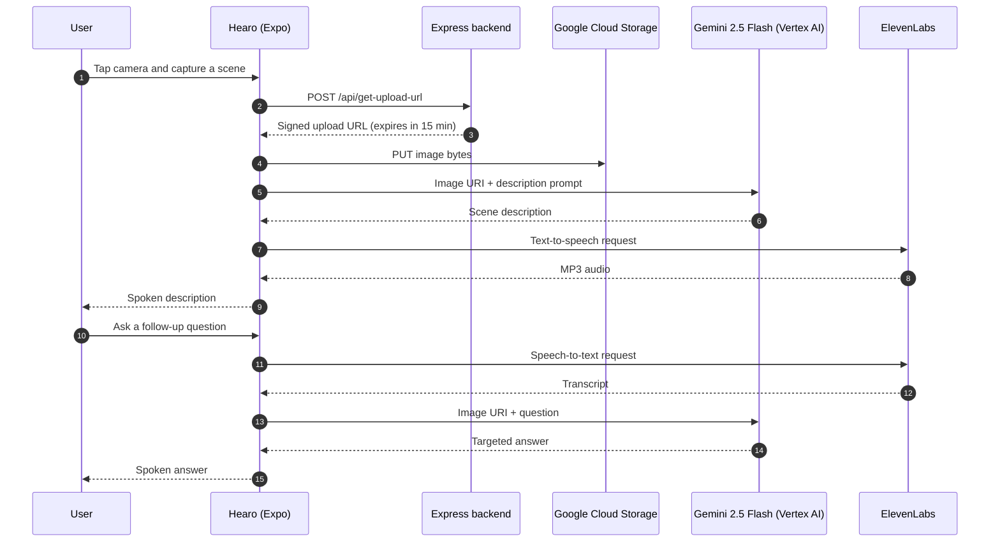

<p align="center">
  
</p>

<h1 align="center">Hearo</h1>

<p align="center">
  <strong>Point. Capture. Hear.</strong><br />
  An AI-powered vision assistant that describes the world out loud.
</p>

<p align="center">
  <a href="https://expo.dev"></a>
  <a href="https://reactnative.dev"></a>
  <a href="https://www.typescriptlang.org"></a>
  <a href="https://nodejs.org"></a>
  
</p>

> **Built at AI ATL 2025.** Hearo was created at the AI ATL hackathon in Atlanta as an accessibility-first, voice-first way to explore the world with a phone camera.

---

## Overview

For people who are blind or have low vision, everyday scenes — a menu on a wall, an approaching bus, a crowded room — can be difficult or impossible to read at a glance.

**Hearo** turns an ordinary smartphone into a narrating companion. Open the app, point the camera at a scene, and Hearo captures a photo, understands it with **Google Gemini 2.5 Flash**, and describes it in a natural **ElevenLabs** voice. If you need more detail, ask a question out loud: Hearo transcribes your voice, answers the question about the scene, and speaks the answer back.

The name is a blend of **hear** and **hero** — because a little help seeing the world should feel empowering, not clinical.

## Features

- 📸 **One-tap scene capture** — a large, high-contrast camera button opens the camera; tap anywhere to capture and Hearo automatically moves to the analysis screen.
- 🧠 **Context-aware descriptions** — Gemini 2.5 Flash is prompted to speak directly to the user ("in front of you…", "you are seeing…") and to focus on the most important objects, people, actions, and signs.
- 🎙️ **Voice follow-up questions** — record a question such as *"What does the sign say?"* or *"Is there a chair nearby?"* ElevenLabs Scribe transcribes it, and the answer is generated against the captured image.
- 🔊 **Natural spoken answers** — ElevenLabs Turbo TTS reads descriptions aloud, with a graceful fallback to the device's built-in speech engine if the API is unavailable.
- 🎚️ **Adjustable speech speed** — a large custom slider ranges from **0.7× to 1.2×** and announces the selected speed out loud.
- 🦻 **Audio-first onboarding** — the "How to Use" button speaks a complete walkthrough, so the app never depends on reading a manual.
- ♿ **Accessibility-minded UI** — oversized touch targets, high-contrast purple-and-white styling, haptic feedback, and minimal chrome.
- 🔁 **Front/back camera switching** — flip between the rear camera for the scene and the front camera for self-description.
- ☁️ **Signed image uploads** — the mobile app never holds a Google Cloud service-account key; uploads use short-lived signed URLs issued by a backend.
- 🐳 **Cloud-ready backend** — a small Express service with a Dockerfile and Google Cloud Run deployment path.

## How It Works




## Tech Stack

| Layer | Technologies |
| --- | --- |
| **Mobile app** | React Native 0.81, Expo SDK 54, TypeScript, React Navigation 7 |
| **Device APIs** | `expo-camera`, `expo-av`, `expo-file-system`, `expo-haptics`, `expo-media-library`, `expo-speech` |
| **Vision AI** | Google Gemini 2.5 Flash via Vertex AI (`@google/genai`) |
| **Speech** | ElevenLabs Text-to-Speech (`eleven_turbo_v2`) and Speech-to-Text (`scribe_v1`) |
| **Backend** | Node.js, Express 4, `@google-cloud/storage`, CORS |
| **Cloud** | Google Cloud Storage, Cloud Run, service accounts, V4 signed URLs |
| **Tooling** | Docker, Expo CLI, ESLint |

## Project Structure

```text
Hearo/
├── backend/
│   ├── server.js              # Express API: health check + GCS signed URL generation
│   ├── package.json
│   ├── Dockerfile             # Cloud Run-ready container image
│   ├── .dockerignore
│   └── .gitignore
│
├── mobile/
│   ├── App.tsx                # Root component and React Navigation stack
│   ├── app/
│   │   ├── index.tsx          # Home screen: logo, camera button, spoken tutorial
│   │   ├── camera.tsx         # Full-screen camera capture
│   │   ├── tts.tsx            # Analysis screen: Gemini, STT, TTS, speed slider
│   │   ├── modal.tsx          # Starter modal screen
│   │   └── _layout.tsx        # Expo Router scaffold (not used by the current entry point)
│   ├── components/
│   │   ├── elevenlabs/
│   │   │   ├── tts.ts         # ElevenLabs TTS + native speech fallback
│   │   │   └── stt-native.ts  # Microphone recording + ElevenLabs STT
│   │   └── google-image-understanding/
│   │       ├── image-request.ts   # Gemini 2.5 Flash image + prompt request
│   │       ├── upload-image.ts    # Signed-URL image upload flow
│   │       └── gcs-signed-url.ts  # Reference implementation for the backend
│   ├── assets/images/         # Hearo logo, icons, splash assets
│   ├── constants/             # Theme colors and layout constants
│   ├── hooks/                 # Color scheme and theme hooks
│   ├── app.json               # Expo configuration and permissions
│   ├── package.json
│   └── tsconfig.json
│
├── README.md
└── package-lock.json
```

## Getting Started

### Prerequisites

- **Node.js 20+** and npm
- **Expo Go** on a physical device, or Android Studio / Xcode for a native build
- A **Google Cloud project** with the Vertex AI and Cloud Storage APIs enabled
- An **ElevenLabs API key** with Text-to-Speech and Speech-to-Text access
- *Optional:* Docker and the `gcloud` CLI for deploying the backend

### 1. Clone the repository

```bash
git clone https://github.com/shawnaks/Hearo.git
cd Hearo
```

### 2. Configure Google Cloud

Hearo uses Cloud Storage as a staging area for captured images so that Gemini can read them by URI.

```bash
# Select your project
gcloud config set project YOUR_PROJECT_ID

# Enable the APIs used by the project
gcloud services enable \
  aiplatform.googleapis.com \
  storage.googleapis.com \
  run.googleapis.com

# Create an image bucket (any globally unique name)
gcloud storage buckets create gs://YOUR_BUCKET_NAME --location=us-central1
```

Create a backend service account and grant it permission to manage uploads and sign URLs:

```bash
gcloud iam service-accounts create hearo-backend \
  --display-name="Hearo backend"

gcloud projects add-iam-policy-binding YOUR_PROJECT_ID \
  --member="serviceAccount:hearo-backend@YOUR_PROJECT_ID.iam.gserviceaccount.com" \
  --role="roles/storage.objectAdmin"

# Required so the service account can sign V4 URLs
gcloud iam service-accounts add-iam-policy-binding \
  hearo-backend@YOUR_PROJECT_ID.iam.gserviceaccount.com \
  --member="serviceAccount:hearo-backend@YOUR_PROJECT_ID.iam.gserviceaccount.com" \
  --role="roles/iam.serviceAccountTokenCreator"
```

Give the Vertex AI service agent read access to the bucket so Gemini can fetch uploaded images:

```bash
PROJECT_NUMBER=$(gcloud projects describe YOUR_PROJECT_ID --format="value(projectNumber)")

gcloud storage buckets add-iam-policy-binding gs://YOUR_BUCKET_NAME \
  --member="serviceAccount:service-${PROJECT_NUMBER}@gcp-sa-aiplatform.iam.gserviceaccount.com" \
  --role="roles/storage.objectViewer"
```

Finally, create an **API key** in **Google Cloud Console → APIs & Services → Credentials** for the mobile app, and enable the **Vertex AI API** for the project.

> If your organization restricts API keys, route Gemini requests through the backend instead and keep the key server-side.

### 3. Run the backend

```bash
cd backend
npm install
```

Set the required environment variables.

**macOS / Linux**

```bash
export GCP_PROJECT_ID="your-project-id"
export GCS_BUCKET_NAME="your-bucket-name"
export GOOGLE_APPLICATION_CREDENTIALS="$PWD/service-account-key.json"
npm start
```

**Windows PowerShell**

```powershell
$env:GCP_PROJECT_ID="your-project-id"
$env:GCS_BUCKET_NAME="your-bucket-name"
$env:GOOGLE_APPLICATION_CREDENTIALS="$PWD\service-account-key.json"
npm start
```

For local development with a service-account key, create one first (the file is already git-ignored):

```bash
gcloud iam service-accounts keys create service-account-key.json \
  --iam-account=hearo-backend@YOUR_PROJECT_ID.iam.gserviceaccount.com
```

The server starts on **port 8080** by default. Verify it with:

```bash
curl http://localhost:8080/health
# {"status":"ok","timestamp":"..."}
```

#### Run the backend with Docker

```bash
docker build -t hearo-backend ./backend

docker run --rm -p 8080:8080 \
  -e GCP_PROJECT_ID="your-project-id" \
  -e GCS_BUCKET_NAME="your-bucket-name" \
  -e GOOGLE_APPLICATION_CREDENTIALS="/tmp/key.json" \
  -v "$PWD/backend/service-account-key.json:/tmp/key.json:ro" \
  hearo-backend
```

#### Deploy the backend to Cloud Run

```bash
gcloud run deploy hearo-backend \
  --source ./backend \
  --region us-central1 \
  --allow-unauthenticated \
  --service-account hearo-backend@YOUR_PROJECT_ID.iam.gserviceaccount.com \
  --set-env-vars GCP_PROJECT_ID=YOUR_PROJECT_ID,GCS_BUCKET_NAME=YOUR_BUCKET_NAME
```

Cloud Run supplies credentials automatically through its attached service account, so no JSON key is needed in production. Copy the resulting service URL — it becomes `EXPO_PUBLIC_BACKEND_URL` in the mobile app.

### 4. Run the mobile app

```bash
cd mobile
npm install
```

Create `mobile/.env`:

```dotenv
EXPO_PUBLIC_ELEVENLABS_API_KEY=your_elevenlabs_api_key
EXPO_PUBLIC_GOOGLE_API_KEY=your_google_cloud_api_key
EXPO_PUBLIC_BACKEND_URL=http://localhost:8080
```

> `EXPO_PUBLIC_*` variables are bundled into the client app. See [Security & Production Notes](#security--production-notes) before shipping a public build.

Start Expo:

```bash
npm start
```

Then press `a` for an Android emulator, `i` for an iOS simulator, or scan the QR code with **Expo Go** on a physical device.

You can also launch a target directly:

```bash
npm run android    # native Android build
npm run ios        # native iOS build (macOS only)
npm run web        # browser preview
```

